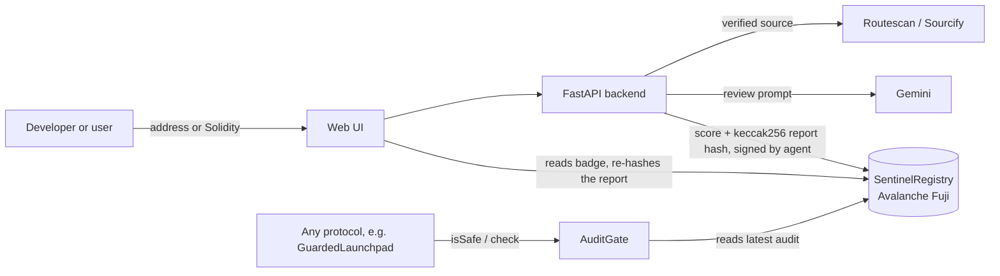

# SentinelAgent

[Tiếng Việt](README.md) | **English**

**An AI smart-contract auditor whose verdict lives on Avalanche, so other contracts can read it and refuse to touch anything that is not safe.**

Most AI audit tools stop at a report on a screen. SentinelAgent turns the result into
**on-chain data**: a safety score and a tamper-evident hash of the full report, written to a
registry on Avalanche Fuji. A second contract, `AuditGate`, reads that registry, so a launchpad,
vault or DEX can block unaudited or low-score contracts **in code**, with no human in the loop.

## Who it is for

- **Developers** who want a quick check on their contract before launch.
- **Protocols** such as launchpads, vaults and DEXs that want to block unaudited or low-score contracts in code, with no manual review.
- **Users** who want to verify an audit result on Snowtrace instead of taking the project's word for it.

## Why use SentinelAgent

- The result is **on-chain data** that other contracts can read, not just a report for people.
- The score comes from a fixed formula: the same list of findings always gives the same score.
- The UI re-hashes the displayed report and compares it with the stamped hash, so you can tell whether the report was altered.
- Every stamp shows gas, fee and confirmation time measured from the real transaction receipt.

**Not for:** replacing a professional audit or protecting real funds. This is a testnet tool, see the limits section below.

## How it works



1. **Audit.** The backend fetches the verified source of a contract (Routescan, then Sourcify), asks Gemini
   for findings (title, severity, function, fix), and computes the score with a fixed formula.
2. **Stamp.** The agent wallet signs a transaction that stores `{target, timestamp, score, reportHash}`
   in `SentinelRegistry`. History is kept: every audit is appended, nothing is overwritten.
3. **Verify.** The web page reads the registry straight from the chain (not through our backend),
   re-hashes the report it shows, and says whether it matches what was stamped.
4. **Gate.** `AuditGate.check(target)` returns one of `NotAudited`, `ScoreTooLow`, `Expired`, `Safe`.
   `GuardedLaunchpad` is a small example protocol that refuses to list anything that is not `Safe`.
5. **Fix.** From the findings, the AI proposes a patched contract and the backend audits the patch again,
   so you see the score before and after.

## Why Avalanche

- **Cheap, fast stamping.** Every stamp shows its measured confirmation time, gas and fee in the UI
  (`confirm_seconds`, `gas_used`, `fee_avax`), taken from the real transaction receipt.
- **EVM-compatible**, so the registry, the gate and the example launchpad are ordinary Solidity 0.8.24
  contracts that any C-Chain protocol can call.
- **Public evidence.** Anyone can open the registry on Snowtrace and check an audit without trusting us.

## Deployed contracts (Avalanche Fuji, chain id 43113)

| Contract | Address |
|---|---|
| SentinelRegistry | [`0x2ABfB402211b16de90c7411434a7E64CC33a5Dc7`](https://testnet.snowtrace.io/address/0x2ABfB402211b16de90c7411434a7E64CC33a5Dc7) (verified) |
| AuditGate | [`0x29F642d06A62956747D5b5d4d03a8f4d21f9ab97`](https://testnet.snowtrace.io/address/0x29F642d06A62956747D5b5d4d03a8f4d21f9ab97) (verified) |
| GuardedLaunchpad | [`0x416001B4cbe88352531F41854A8AeBde8Fb0A8bD`](https://testnet.snowtrace.io/address/0x416001B4cbe88352531F41854A8AeBde8Fb0A8bD) (verified) |
| VulnerableVault (sample, verified) | [`0x67F23Ed0410ABc1B6FC6fCE7FEEc9c58ff7C346A`](https://testnet.snowtrace.io/address/0x67F23Ed0410ABc1B6FC6fCE7FEEc9c58ff7C346A) |
| FixedVault (sample, verified) | [`0x9Ba8E1eBb127510E8881440105254955D3bf1691`](https://testnet.snowtrace.io/address/0x9Ba8E1eBb127510E8881440105254955D3bf1691) |

## Score

`score = round(100 * 0.5 ^ (penalty / 40))`, where each finding adds a penalty:
critical 40, high 25, medium 10, low 3, info 0.

Every 40 penalty points halve the score, so it keeps falling but never gets stuck at 0.
One high-severity finding gives 65, one critical gives 50, two lows give 90. The same findings always give
the same number. The AI decides which findings exist and their severity, and that part can vary between runs.

## Quick start (Windows PowerShell)

```powershell
git clone https://github.com/vamosaceclutch/Sentinel-Agent.git
cd Sentinel-Agent
python -m venv .venv
.venv\Scripts\Activate.ps1
pip install -r requirements.txt
copy .env.example .env        # then fill in GEMINI_API_KEY and AGENT_PRIVATE_KEY

# terminal 1: backend
python -m uvicorn app:app --reload

# terminal 2: web page
python -m http.server 5500
# open http://127.0.0.1:5500/UI.html
```

The agent wallet needs a little test AVAX from the [Avalanche faucet](https://faucet.avax.network/)
and must be the `agent` address of the deployed registry.

Command line: `python send_audit.py <file.sol | 0xAddress> [--record]`

## API

| Method and path | Body | Returns |
|---|---|---|
| `POST /audit` | `{"address": "0x..."}` or `{"code": "..."}`, optional `"record_on_chain": true` (address only) | `score`, `summary`, `findings[]`, `model`, `truncated`, optional `on_chain` with `tx_hash`, `report_hash`, `gas_used`, `fee_avax`, `confirm_seconds` |
| `POST /patch` | `{"address" or "code", "findings": [...]}` | `patched_code`, `changes[]`, `score_before`, `score_after`, `findings_after[]` |

On-chain stamping needs an `address`: the agent fetches the verified source itself instead of trusting pasted code.

## Measured detection

`benchmark.py` sends 8 small contracts, each with one known flaw, plus one clean contract. A flaw counts as
detected when the report names that kind of issue. First run, before the scoring and prompt changes, 3 runs each:

| Contract | Detected | Scores over 3 runs |
|---|---|---|
| reentrancy | 3/3 | 60, 60, 60 |
| tx.origin | 3/3 | 75, 72, 75 |
| missing access control | 3/3 | 35, 35, 20 |
| selfdestruct | 3/3 | 50, 50, 50 |
| delegatecall | 3/3 | 60, 60, 60 |
| unchecked low-level call | 3/3 | 75, 75, 75 |
| weak randomness | 3/3 | 30, 40, 55 |
| oracle manipulation | 3/3 | 25, 25, 25 |

Second run, **after** the scoring and prompt changes, 1 run per contract (the free Gemini tier allows about 20 calls a day,
so 3 runs were not possible). `python benchmark.py 1 after` writes the results to `benchmark_after.json`:

| Contract | Detected | Score |
|---|---|---|
| reentrancy | 1/1 | 50 |
| tx.origin | 1/1 | 62 |
| missing access control | 1/1 | 25 |
| selfdestruct | 1/1 | 50 |
| delegatecall | 1/1 | 50 |
| unchecked low-level call | 1/1 | 65 |
| weak randomness | 1/1 | 30 |
| oracle manipulation | 1/1 | 16 |
| clean control contract | 1/1 | 100 |

All 8 flaw types were detected and the clean contract scored 100. The scoring formula and prompt changed, so these scores
are not directly comparable with the table above. With a single run, this table **does not measure score stability** between runs.
Read these numbers for what they are: the contracts are small, written by us, and each flaw is textbook.
This shows the pipeline works and how stable the score is. It does not show how well the tool performs on
large real-world contracts.

## Security model and limits

- Only the `agent` address can write to the registry. The gate trusts that one key: whoever holds it can issue
  any score. A production version would use several independent auditors.
- The AI can miss issues, invent issues, and change a severity between runs. This is not a formal audit and does
  not replace one.
- Very long contracts are cut at 60,000 characters. The response says so (`truncated: true`) and the UI warns.
- The suggested patch is written by AI, is not compiled by this tool, and must be reviewed before use.
- A passing score says the AI found no serious problem in the code it read. It is not a guarantee of safety.
- Testnet only. Use a testnet-only wallet for the agent key and never commit `.env`.

## Tests

```powershell
pip install -r requirements-dev.txt
python tests/test_backend.py        # scoring, endpoints, fallback model, receipt metrics (fake Gemini)
```

`tests/gate/` compiles the contracts and tests every `AuditGate` verdict on a local in-memory EVM (see its README).

## Project layout

```
app.py                FastAPI: /audit and /patch
audit.py              source fetching, Gemini review, scoring, patch suggestion
chain.py              hashing and signing, writes to the registry, receipt metrics
UI.html               single-file web page (ethers.js reads the chain directly)
SentinelRegistry.sol  on-chain log of audits (only the agent can write)
AuditGate.sol         AuditGate and the example GuardedLaunchpad
samples/              VulnerableVault, SafeVault, FixedVault (hand-written fix)
benchmark.py          detection and stability benchmark
tests/                backend tests and AuditGate tests
```

## Roadmap

- Several independent auditors that must agree before a contract passes the gate.
- Cross-check the AI with a static analyzer such as Slither.
- Expire a badge when the contract's bytecode or proxy implementation changes.
- Let the user pay the stamping gas through an agent-signed certificate.
- Cross-chain use of the same verdicts.

## License

MIT
