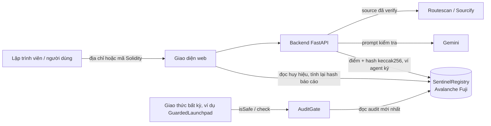

# SentinelAgent

[Tiếng Việt](README.md) | [English](README.en.md)

**Công cụ AI kiểm định smart contract, có kết quả được ghi lên Avalanche để các contract khác tự đọc và tự từ chối mọi thứ không an toàn.**

Phần lớn công cụ audit bằng AI chỉ dừng ở một bản báo cáo trên màn hình. SentinelAgent biến kết quả thành
**dữ liệu trên blockchain**: điểm an toàn cùng mã băm (hash) của toàn bộ báo cáo, ghi vào một sổ đăng ký
(registry) trên Avalanche Fuji. Một contract thứ hai là `AuditGate` đọc registry đó, nhờ vậy launchpad,
vault hay DEX có thể chặn contract chưa audit hoặc điểm thấp **ngay trong code**, không cần con người duyệt.

## Dành cho ai

- **Nhà phát triển** muốn có một điểm kiểm tra nhanh cho contract của mình trước khi ra mắt.
- **Giao thức** như launchpad, vault, DEX muốn chặn contract chưa audit hoặc điểm thấp ngay trong code, không cần người duyệt tay.
- **Người dùng** muốn tự kiểm chứng kết quả audit trên Snowtrace thay vì tin lời dự án.

## Vì sao dùng SentinelAgent

- Kết quả là **dữ liệu trên chain** mà contract khác đọc được, không chỉ là một báo cáo cho người đọc.
- Điểm do một công thức cố định tính: cùng một danh sách lỗi luôn ra cùng một điểm.
- Giao diện tính lại hash của báo cáo và so với hash đã đóng dấu, nên biết báo cáo có bị sửa hay không.
- Mỗi lần đóng dấu hiện gas, phí và thời gian xác nhận đo từ biên lai giao dịch thật.

**Không dành cho:** thay thế audit chuyên nghiệp hoặc bảo vệ tiền thật. Đây là công cụ chạy trên testnet, xem phần giới hạn bên dưới.

## Cách hoạt động



1. **Audit.** Backend lấy source đã verify của contract (Routescan, rồi Sourcify), nhờ Gemini tìm lỗi
   (tiêu đề, mức nghiêm trọng, hàm, cách sửa) và tính điểm bằng một công thức cố định.
2. **Đóng dấu (stamp).** Ví agent ký một giao dịch lưu `{target, timestamp, score, reportHash}`
   vào `SentinelRegistry`. Lịch sử được giữ: mỗi lần audit là một dòng mới, không ghi đè.
3. **Kiểm chứng.** Trang web đọc registry trực tiếp từ chain (không qua backend của chúng tôi),
   tính lại hash của báo cáo đang hiển thị và cho biết có khớp với hash đã đóng dấu hay không.
4. **Cổng chặn.** `AuditGate.check(target)` trả về một trong bốn kết luận: `NotAudited` (chưa audit), `ScoreTooLow` (điểm thấp),
   `Expired` (audit quá cũ), `Safe` (đạt). `GuardedLaunchpad` là một giao thức mẫu, từ chối niêm yết mọi thứ không phải `Safe`.
5. **Vá lỗi.** Từ danh sách lỗi, AI đề xuất một bản contract đã sửa, backend audit lại bản đó
   để bạn thấy điểm trước và sau.

## Vì sao là Avalanche

- **Đóng dấu rẻ và nhanh.** Mỗi lần đóng dấu hiển thị thời gian xác nhận, gas và phí đo được ngay trên giao diện
  (`confirm_seconds`, `gas_used`, `fee_avax`), lấy từ biên lai giao dịch thật.
- **Tương thích EVM**, nên registry, cổng và launchpad mẫu đều là contract Solidity 0.8.24 bình thường
  mà bất kỳ giao thức nào trên C-Chain cũng gọi được.
- **Bằng chứng công khai.** Ai cũng mở được registry trên Snowtrace để kiểm tra một audit mà không cần tin chúng tôi.

## Contract đã deploy (Avalanche Fuji, chain id 43113)

| Contract | Địa chỉ |
|---|---|
| SentinelRegistry | [`0x2ABfB402211b16de90c7411434a7E64CC33a5Dc7`](https://testnet.snowtrace.io/address/0x2ABfB402211b16de90c7411434a7E64CC33a5Dc7) (đã verify) |
| AuditGate | [`0x29F642d06A62956747D5b5d4d03a8f4d21f9ab97`](https://testnet.snowtrace.io/address/0x29F642d06A62956747D5b5d4d03a8f4d21f9ab97) (đã verify) |
| GuardedLaunchpad | [`0x416001B4cbe88352531F41854A8AeBde8Fb0A8bD`](https://testnet.snowtrace.io/address/0x416001B4cbe88352531F41854A8AeBde8Fb0A8bD) (đã verify) |
| VulnerableVault (mẫu, đã verify) | [`0x67F23Ed0410ABc1B6FC6fCE7FEEc9c58ff7C346A`](https://testnet.snowtrace.io/address/0x67F23Ed0410ABc1B6FC6fCE7FEEc9c58ff7C346A) |
| FixedVault (mẫu, đã verify) | [`0x9Ba8E1eBb127510E8881440105254955D3bf1691`](https://testnet.snowtrace.io/address/0x9Ba8E1eBb127510E8881440105254955D3bf1691) |

## Điểm số

`score = round(100 * 0.5 ^ (penalty / 40))`, trong đó mỗi lỗi cộng một mức phạt:
critical 40, high 25, medium 10, low 3, info 0.

Cứ 40 điểm phạt thì điểm giảm một nửa, nên điểm luôn giảm dần mà không bị kẹt cứng ở 0.
Một lỗi high cho 65, một lỗi critical cho 50, hai lỗi low cho 90. Cùng một danh sách lỗi luôn ra cùng một điểm.
AI quyết định có những lỗi nào và mức nghiêm trọng của chúng, phần này có thể thay đổi giữa các lần chạy.

## Chạy nhanh (Windows PowerShell)

```powershell
git clone https://github.com/vamosaceclutch/Sentinel-Agent.git
cd Sentinel-Agent
python -m venv .venv
.venv\Scripts\Activate.ps1
pip install -r requirements.txt
copy .env.example .env        # rồi điền GEMINI_API_KEY và AGENT_PRIVATE_KEY

# terminal 1: backend
python -m uvicorn app:app --reload

# terminal 2: trang web
python -m http.server 5500
# mở http://127.0.0.1:5500/UI.html
```

Ví agent cần một ít AVAX testnet từ [faucet của Avalanche](https://faucet.avax.network/)
và phải là địa chỉ `agent` của registry đã deploy.

Dòng lệnh: `python send_audit.py <file.sol | 0xĐịaChỉ> [--record]`

## API

| Phương thức và đường dẫn | Nội dung gửi | Trả về |
|---|---|---|
| `POST /audit` | `{"address": "0x..."}` hoặc `{"code": "..."}`, tùy chọn `"record_on_chain": true` (chỉ với địa chỉ) | `score`, `summary`, `findings[]`, `model`, `truncated`, và `on_chain` (nếu có) gồm `tx_hash`, `report_hash`, `gas_used`, `fee_avax`, `confirm_seconds` |
| `POST /patch` | `{"address" hoặc "code", "findings": [...]}` | `patched_code`, `changes[]`, `score_before`, `score_after`, `findings_after[]` |

Đóng dấu lên chain cần có `address`: agent tự lấy source đã verify thay vì tin mã do người dùng dán.

## Kết quả đo khả năng phát hiện

`benchmark.py` gửi 8 contract nhỏ, mỗi contract có một lỗi đã biết, cùng một contract sạch. Một lỗi được tính là
phát hiện khi báo cáo nêu đúng loại lỗi đó. Lần chạy đầu, trước khi đổi công thức điểm và prompt, mỗi contract 3 lần:

| Contract | Phát hiện | Điểm qua 3 lần |
|---|---|---|
| reentrancy | 3/3 | 60, 60, 60 |
| tx.origin | 3/3 | 75, 72, 75 |
| thiếu kiểm soát quyền (missing access control) | 3/3 | 35, 35, 20 |
| selfdestruct | 3/3 | 50, 50, 50 |
| delegatecall | 3/3 | 60, 60, 60 |
| low-level call không kiểm tra kết quả | 3/3 | 75, 75, 75 |
| số ngẫu nhiên yếu (weak randomness) | 3/3 | 30, 40, 55 |
| thao túng oracle (oracle manipulation) | 3/3 | 25, 25, 25 |

Lần chạy thứ hai, **sau** khi đổi công thức điểm và prompt, mỗi contract 1 lần (gói Gemini miễn phí chỉ cho khoảng 20 lượt mỗi ngày
nên không chạy được 3 lần). Lệnh `python benchmark.py 1 after` ghi kết quả vào `benchmark_after.json`:

| Contract | Phát hiện | Điểm |
|---|---|---|
| reentrancy | 1/1 | 50 |
| tx.origin | 1/1 | 62 |
| thiếu kiểm soát quyền (missing access control) | 1/1 | 25 |
| selfdestruct | 1/1 | 50 |
| delegatecall | 1/1 | 50 |
| low-level call không kiểm tra kết quả | 1/1 | 65 |
| số ngẫu nhiên yếu (weak randomness) | 1/1 | 30 |
| thao túng oracle (oracle manipulation) | 1/1 | 16 |
| contract sạch (đối chứng) | 1/1 | 100 |

Cả 8 loại lỗi đều được phát hiện và contract sạch được 100 điểm. Công thức điểm và prompt đã đổi nên điểm không so sánh trực tiếp
với bảng trước. Vì chỉ chạy 1 lần, bảng này **chưa đo được độ ổn định** của điểm giữa các lần chạy.
Hãy đọc các con số này đúng như bản chất: contract nhỏ, do chính chúng tôi viết, và mỗi lỗi đều là lỗi trong sách giáo khoa.
Chúng cho thấy quy trình chạy được và điểm ổn định đến đâu. Chúng không cho thấy công cụ hoạt động tốt đến mức nào
trên các contract thật, lớn.

## Mô hình bảo mật và giới hạn

- Chỉ địa chỉ `agent` mới ghi được vào registry. Cổng tin vào đúng một khóa này: ai giữ khóa đó có thể cấp
  điểm tùy ý. Bản thực tế nên dùng nhiều auditor độc lập.
- AI có thể bỏ sót lỗi, bịa ra lỗi và đổi mức nghiêm trọng giữa các lần chạy. Đây không phải audit chính thức và
  không thay thế audit chuyên nghiệp.
- Contract rất dài bị cắt ở 60.000 ký tự. Phản hồi báo rõ (`truncated: true`) và giao diện có cảnh báo.
- Bản vá do AI đề xuất không được công cụ này biên dịch, và phải được người xem xét trước khi dùng.
- Điểm đạt chỉ cho biết AI không thấy lỗi nghiêm trọng trong phần code nó đọc. Đó không phải cam kết an toàn.
- Chỉ chạy trên testnet. Dùng ví chỉ dành cho testnet làm khóa agent và không bao giờ commit `.env`.

## Kiểm thử

```powershell
pip install -r requirements-dev.txt
python tests/test_backend.py        # công thức điểm, endpoint, model dự phòng, số liệu biên lai (Gemini giả)
```

`tests/gate/` biên dịch các contract và kiểm tra mọi kết luận của `AuditGate` trên một EVM cục bộ trong bộ nhớ (xem README trong thư mục đó).

## Cấu trúc dự án

```
app.py                FastAPI: /audit và /patch
audit.py              lấy source, nhờ Gemini kiểm tra, tính điểm, đề xuất bản vá
chain.py              tính hash, ký, ghi vào registry, số liệu biên lai
UI.html               trang web một file (ethers.js đọc chain trực tiếp)
SentinelRegistry.sol  sổ ghi audit trên chain (chỉ agent được ghi)
AuditGate.sol         AuditGate và GuardedLaunchpad mẫu
samples/              VulnerableVault, SafeVault, FixedVault (bản sửa viết tay)
benchmark.py          benchmark khả năng phát hiện và độ ổn định
tests/                test backend và test AuditGate
```

## Hướng phát triển

- Nhiều auditor độc lập phải đồng thuận trước khi một contract qua cổng.
- Đối chiếu kết quả AI với công cụ phân tích tĩnh như Slither.
- Làm huy hiệu hết hạn khi bytecode hoặc implementation của proxy thay đổi.
- Cho người dùng trả gas đóng dấu thông qua chứng nhận do agent ký.
- Dùng cùng các kết luận này trên nhiều chain.

## Giấy phép

MIT
